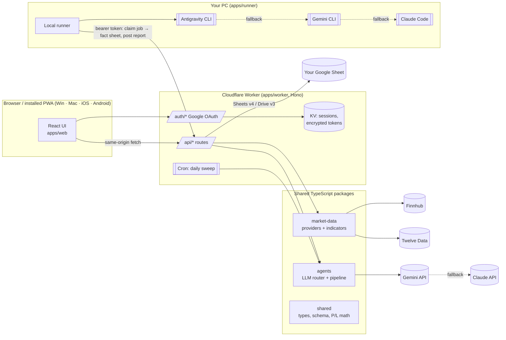

# TradeAgent — Trading Analysis Agent

A personal **portfolio + watchlist** web app with **live market prices** and a **multi-agent AI research team**.

- **UI:** simple and calm like Wealthsimple, dense where it counts like Yahoo Finance.
- **Agents:** a TradingAgents-style flow (analysts → bull/bear debate → trader → risk → portfolio manager) that ends in a daily_stock_analysis-style **decision dashboard**.
- **Runs on:** Windows, macOS, iOS and Android as an installable PWA.
- **Hosting:** Cloudflare Workers.
- **Data:** stored in **your own Google Sheet**.

> ⚠️ For research and education only. **Not financial advice.** AI output can be wrong; verify before acting.

---

## Features

| Area | What you get |
|---|---|
| **Portfolio** | Positions are derived from your transaction log using the average-cost method. You get live market value, today's change, unrealized and realized P/L, dividends, an allocation bar, and multiple accounts (TFSA, RRSP, Margin…). |
| **Watchlists** | Multiple named lists, live quotes (refreshed every 15 s), and the latest AI verdict per symbol. |
| **Symbol page** | Price chart (1M–5Y) with SMA50, technicals (MA alignment, RSI, MACD, ATR, bias vs MA5, 52-week range), fundamentals, 7-day news, and analysis history. |
| **Quick analysis** | The *daily_stock_analysis* method. One LLM call returns a decision dashboard: verdict, confidence, **buy point**, target, **stop loss**, reward/risk, reasons, risks and a checklist. |
| **Deep analysis** | The *TradingAgents* method. Eight LLM calls run a multi-agent team: Technical, Fundamentals and News analysts, then Bull vs Bear researchers, then Trader, Risk Manager, and a Portfolio Manager who makes the final **Buy / Hold / Sell** call. The full debate transcript is kept. |
| **House rules in code** | After the model answers, code enforces the trading discipline. Price more than 5% above MA5 never gets a BUY ("don't chase"), and the buy point moves to MA5. The stop must be below the buy point and the target above it. Reward/risk and the trend and chasing checklist items are computed, not guessed. |
| **Daily sweep** | A Cloudflare cron job runs after the US close (21:30 UTC, Mon–Fri). It quick-analyzes every watchlist symbol, saves the results to your sheet, and can optionally send a digest to Telegram. |
| **AI engines** | **Local runner (no API keys):** a small script on your PC answers the analyses with **Antigravity CLI**, **Gemini CLI** or **Claude Code**, so it uses your Google AI plan and Claude subscriptions. **Or cloud API keys:** the Worker calls Gemini, with Claude as the automatic fallback. |
| **Market data** | **Finnhub** supplies real-time quotes, search, profile, fundamentals and news. **Twelve Data** supplies daily OHLCV history and a backup quote source. |
| **Storage** | A Google Sheet named *"Trading Analysis Agent — Database"* is created in your Drive on first sign-in. You can open it, edit it and export it at any time. |

## Architecture



Use **either** the cloud API keys **or** the local runner. With no Gemini or Anthropic key set, the app queues analyses for the runner automatically (`AI_ENGINE` overrides this).

More detail: [docs/ARCHITECTURE.md](docs/ARCHITECTURE.md) · [docs/DATA_MODEL.md](docs/DATA_MODEL.md) · [docs/API.md](docs/API.md) · [docs/AI_AGENTS.md](docs/AI_AGENTS.md)

## Project structure

```
trading-analysis-agent/
├── apps/
│   ├── web/                  # React 19 + Vite PWA (UI)
│   │   ├── public/           # manifest, service worker, icons, _headers (CSP)
│   │   └── src/{components,hooks,lib,pages}
│   ├── worker/               # Cloudflare Worker (Hono): API, OAuth, cron, runner queue
│   │   ├── src/{lib,routes,services}
│   │   ├── wrangler.jsonc
│   │   └── .dev.vars.example
│   └── runner/               # Local AI runner (Node, your PC): Antigravity / Gemini CLI / Claude Code
│       ├── src/{engines,api.ts,cli.ts,config.ts}
│       └── runner.env.example
├── packages/
│   ├── shared/               # domain types, Google Sheets schema, portfolio math (+ tests)
│   ├── market-data/          # Finnhub + Twelve Data providers, fallback router, indicators (+ tests)
│   └── agents/               # Gemini/Claude clients, fallback, prompts, multi-agent pipeline (+ tests)
├── docs/                     # architecture, data model, API, agents, setup, ADRs
├── scripts/                  # dev helper scripts
├── .claude/                  # Claude Code settings + slash commands
├── .agent/                   # Antigravity rules + workflows
├── .gemini/                  # Gemini CLI settings
├── .github/workflows/ci.yml  # typecheck + test + build
├── AGENTS.md  CLAUDE.md  GEMINI.md          # AI coding-assistant instructions
├── PROJECT_CONTEXT.md  REQUIREMENTS.md       # product context + requirements
└── package.json              # npm workspaces
```

## Quick start (local, no accounts needed)

Requires **Node.js 20+** (Windows, macOS or Linux).

```bash
npm install
cp apps/worker/.dev.vars.example apps/worker/.dev.vars   # Windows: copy apps\worker\.dev.vars.example apps\worker\.dev.vars
# In .dev.vars keep DEV_AUTH_BYPASS=true, then add any API keys you have
npm run dev
```

Open **http://localhost:5173**.

- `DEV_AUTH_BYPASS=true` skips Google sign-in and stores data in local KV, so the whole UI works offline.
- Prices need `FINNHUB_API_KEY` and/or `TWELVEDATA_API_KEY`.
- AI analysis needs **either** the local runner ([below](#ai-without-api-keys-the-local-runner)) **or** `GEMINI_API_KEY` / `ANTHROPIC_API_KEY`.
- In dev, Vite runs on :5173 and proxies `/api` and `/auth` to `wrangler dev` on :8787.

| Command | What it does |
|---|---|
| `npm run dev` | Worker (:8787) and Vite UI (:5173) together |
| `npm run typecheck` | `tsc` in every workspace |
| `npm test` | Vitest unit tests (portfolio math, indicators, agent pipeline) |
| `npm run build` | Build the UI into `apps/web/dist` |
| `npm run check` | typecheck + test + build (what CI runs) |
| `npm run deploy` | Build, then `wrangler deploy` |
| `npm run runner -- watch` | Local AI runner: answer queued analyses with your CLIs |

## AI without API keys: the local runner

The runner uses the AI subscriptions you already have: your **Google AI plan** through Antigravity CLI or Gemini CLI, and your **Claude** plan through Claude Code. A Cloudflare Worker can't run those CLIs, so a small Node script on your PC does it instead:

1. The app queues the job. This happens when you click **Quick** or **Deep analysis**, and when the daily cron runs.
2. The runner claims the job and receives the **fact sheet**. The Worker builds it: live prices, plus indicators computed in code.
3. The runner runs the same quick or deep pipeline through the CLIs and posts the report back.
4. The Worker **re-checks the report with the house rules** and saves it to your sheet. When the sweep batch finishes, it sends the Telegram digest.

Setup:

1. Install and sign in to at least one CLI:
   - **Antigravity:** `agy`, which installs with Antigravity.
   - **Gemini CLI:** `npm i -g @google/gemini-cli`, then run `gemini` once and choose *Login with Google*.
   - **Claude Code:** run `claude` once and sign in.
2. In the app, open **Settings → Local AI runner → Create runner token**.
3. Copy `apps/runner/runner.env.example` to `apps/runner/runner.env` and set `TAA_URL` and `TAA_RUNNER_TOKEN`.
4. Check the setup with `npm run runner -- doctor --test`, then start the runner with `npm run runner -- watch`. Leave it running.

Other commands:

| Command | What it does |
|---|---|
| `npm run runner -- once` | Answer everything queued now, then exit |
| `npm run runner -- sweep` | Queue the whole watchlist, answer it, then exit. Use `--deep` for the agent team. |
| `npm run runner -- analyze NVDA --deep` | Analyze one symbol |

Engines are tried in the order set by `RUNNER_ENGINES` (default `antigravity,gemini-cli,claude-code`), and CLIs that aren't installed are skipped. Each CLI runs in an empty temp folder with tools blocked: plan mode plus sandbox for `agy`, and disallowed tools for `claude`. The runner token can only call `/api/runner/*`, so it cannot read your portfolio. See [docs/AI_AGENTS.md](docs/AI_AGENTS.md#local-runner).

## Configuration

### 1. API keys

| Secret | Where to get it | Used for |
|---|---|---|
| `GEMINI_API_KEY` | [Google AI Studio](https://aistudio.google.com/apikey) | Primary cloud LLM. *Not needed with the local runner.* |
| `ANTHROPIC_API_KEY` | [Anthropic Console](https://console.anthropic.com/settings/keys) | Fallback cloud LLM. *Not needed with the local runner.* |
| `FINNHUB_API_KEY` | [finnhub.io](https://finnhub.io/dashboard) (free tier) | Quotes, search, profile, fundamentals, news |
| `TWELVEDATA_API_KEY` | [twelvedata.com](https://twelvedata.com/account/api-keys) (free tier) | Daily price history, quote fallback |
| `TELEGRAM_BOT_TOKEN`, `TELEGRAM_CHAT_ID` | @BotFather | Optional daily digest |

> **About the "Google AI plan":** Google AI Pro/Ultra subscriptions raise your limits in the Gemini app, **Gemini CLI** and **Antigravity**. The **local runner** uses those CLIs directly, so no API key is needed. If you prefer the cloud path, the Worker calls the **Gemini Developer API** with an API key from AI Studio. AI Studio has a free tier, and AI Pro includes monthly Cloud credits you can claim in AI Studio. Model IDs are set in `wrangler.jsonc` (`GEMINI_MODEL_FAST/DEEP`, default `gemini-flash-latest` / `gemini-pro-latest`). Check the current list with `GET https://generativelanguage.googleapis.com/v1beta/models`.

### 2. Google sign-in and Sheets (for production)

Full walkthrough: [docs/SETUP.md](docs/SETUP.md).

1. In Google Cloud Console, create a project. Enable the **Google Sheets API** and the **Google Drive API**.
2. Set up the **OAuth consent screen**. Use the External type, add yourself as a test user, and add the scopes `openid`, `email`, `profile` and `.../auth/drive.file`.
3. Create an **OAuth client ID** of type *Web application*. Add these authorized redirect URIs:
   - `http://localhost:5173/auth/callback` (dev)
   - `https://<your-worker>.workers.dev/auth/callback` (prod)
4. Put `GOOGLE_CLIENT_ID` and `GOOGLE_CLIENT_SECRET` in `.dev.vars` (dev) or Worker secrets (prod). Set `DEV_AUTH_BYPASS=false`.

The app only requests `drive.file`. That scope lets it see **only the spreadsheet it creates**, not the rest of your Drive.

### 3. Deploy to Cloudflare Workers

```bash
npx wrangler login
npx wrangler kv namespace create KV          # paste the id into apps/worker/wrangler.jsonc
cd apps/worker
npx wrangler secret put SESSION_SECRET       # long random string
npx wrangler secret put GOOGLE_CLIENT_ID
npx wrangler secret put GOOGLE_CLIENT_SECRET
npx wrangler secret put GEMINI_API_KEY       # skip both AI keys if you use the local runner
npx wrangler secret put ANTHROPIC_API_KEY
npx wrangler secret put FINNHUB_API_KEY
npx wrangler secret put TWELVEDATA_API_KEY
# In wrangler.jsonc "vars", set APP_URL=https://<your-worker>.workers.dev and ALLOWED_EMAILS=you@gmail.com
cd ../.. && npm run deploy
```

`ALLOWED_EMAILS` is **required**. Sign-in is refused for every other account, which protects your API keys.

## Install on your devices

| Device | How |
|---|---|
| Windows / macOS (Chrome, Edge) | Click the install icon in the address bar |
| macOS Safari | File → Add to Dock |
| iPhone / iPad | Share → Add to Home Screen |
| Android | ⋮ menu → Install app |

## Developing with AI assistants

This repo is set up for **Claude Code** and **Google Antigravity / Gemini CLI**:

- [AGENTS.md](AGENTS.md) holds the canonical rules: commands, conventions and boundaries. All tools read it.
- [CLAUDE.md](CLAUDE.md) holds Claude Code specifics. Slash commands live in `.claude/commands/` (`/check`, `/add-market-provider`, `/add-agent`).
- [GEMINI.md](GEMINI.md) holds Gemini CLI and Antigravity specifics. Rules live in `.agent/rules/` and workflows in `.agent/workflows/`.
- To start the local AI runner from the assistant, use the `runner` workflow in Antigravity or `/runner` in Claude Code.
- [PROJECT_CONTEXT.md](PROJECT_CONTEXT.md) and [REQUIREMENTS.md](REQUIREMENTS.md) describe what you are building and why.

## Credits and inspiration

- [TauricResearch/TradingAgents](https://github.com/TauricResearch/TradingAgents): the multi-agent analyst → debate → trader → risk → PM structure.
- [ZhuLinsen/daily_stock_analysis](https://github.com/ZhuLinsen/daily_stock_analysis): the decision dashboard, trend-trading rules (MA alignment, no chasing more than 5% above MA5) and the scheduled daily report.
- Yahoo Finance and Wealthsimple: UI inspiration only. No code or assets are copied.

## License

Private / personal use. Add a license before publishing.
