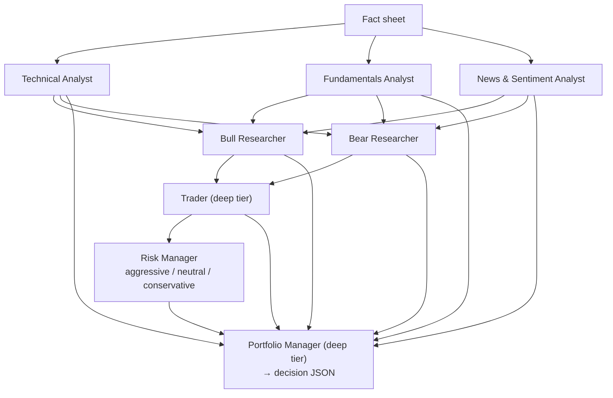
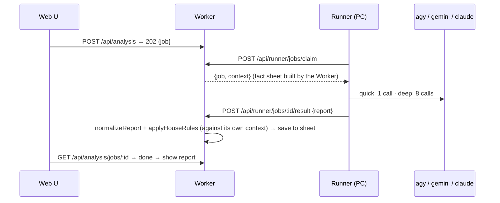

# AI agents

The agents live in [`packages/agents`](../packages/agents/src). The design combines two reference projects:

- **TradingAgents:** the organizational structure (who talks to whom).
- **daily_stock_analysis:** the output contract (the decision dashboard) and the trading discipline.

## Inputs: the fact sheet

`buildContext()` (Worker) gathers the inputs, and `renderContext()` renders them as text:

- Quote, company profile and fundamentals (Finnhub).
- A `TechnicalSnapshot` computed by code from one year of daily candles:
  - SMA 5/10/20/50/200, EMA 12/26, RSI 14, MACD, ATR 14.
  - Bias vs MA5 and MA20, volume ratio, 52-week range, 1M/3M/1Y change.
  - MA alignment and rule signals.
- Up to 10 news headlines from the last 7 days.
- The user's position in that symbol, if any: quantity, average cost, P/L and weight.

Every prompt starts with the **ground rules**: use only these facts, never invent numbers, and say when data is missing.

## Quick mode (1 call, `tier: fast`)

`QUICK_SYSTEM` combines the ground rules, the house trading rules and `REPORT_SCHEMA`. It returns JSON.

Quick mode is used by the **Quick analysis** button and by the daily cron sweep.

## Deep mode (8 calls)

- The analysts run in parallel, and so do the bull and bear researchers.
- Each note is kept in `report.agentNotes`, which the UI shows as the "Agent debate" panel.

## Output: `AnalysisReport`

| Field | Meaning |
|---|---|
| `decision` | `STRONG_BUY` · `BUY` · `HOLD` · `REDUCE` · `SELL` |
| `confidence` | 0–100 |
| `oneLiner` | An actionable one-sentence conclusion |
| `entryPrice` · `targetPrice` · `stopLoss` | The **buy point**, target and stop loss |
| `rewardRisk` | Computed in code from the three levels (null when they don't form a long setup) |
| `ruleNotes` | What the house rules changed, e.g. a "don't chase" downgrade |
| `keyReasons` · `risks` | Short bullet lists |
| `checklist` | Pass/warn/fail on trend, chasing, momentum, fundamentals, news, R/R |
| `agentNotes` | Deep mode transcript |
| `provider` · `model` | Which LLM actually answered |

`normalizeReport()` coerces anything the model returns into this shape: it maps enums, clamps confidence and drops junk.

## What we take from each reference project

| Reference | Its method | Where it lives here |
|---|---|---|
| **TradingAgents** | Specialist analysts, then a bull vs bear debate, then trader, risk management, and a portfolio manager who makes the final Buy / Hold / Sell call | **Deep** mode (`runDeepAnalysis`). The PM's `decision` is the final call on our five-step scale (`STRONG_BUY`…`SELL`). |
| **daily_stock_analysis** | A decision dashboard with a one-line verdict, buy point, stop loss, target and checklist, plus trend-trading discipline ("don't chase" above MA5, bullish MA alignment) | **Quick** mode (`runQuickAnalysis`), the `REPORT_SCHEMA` contract, and the house rules below |

## House trading rules

These rules are stated in the prompts (`prompts.ts → TRADING_RULES`) **and enforced in code** (`rules.ts → applyHouseRules`). The code runs after every quick or deep run, and the Worker runs it again on every report the local runner sends back.

| Rule | Prompt says | Code enforces |
|---|---|---|
| Trend | Prefer MA5 > MA10 > MA20 | The checklist item "Trend" is pass when the computed alignment is bullish, fail when bearish, and warn otherwise |
| **Don't chase** | More than 5% above MA5 means wait for a pullback | The bias vs MA5 sets the checklist item: ≤ 2% pass, 2–5% warn, > 5% fail. Above 5%, a `BUY` or `STRONG_BUY` becomes **`HOLD`**, confidence is capped at 60, and the **buy point moves to MA5** |
| Levels | Always define a stop; favor reward/risk ≥ 2 | A stop at or above the buy point is removed, and so is a target at or below it. Reward/risk is computed and sets the "Reward / risk ≥ 2" item: ≥ 2 pass, ≥ 1 warn, otherwise fail. A buy call with no valid stop gets a note |
| RSI | Above 70 is stretched; below 30 is washed out | Prompt only, because context matters |
| Size | No single position above 20% of the portfolio | Prompt only. The user's weight is in the fact sheet |

Every change is listed in `report.ruleNotes` and shown in the UI under "House rules applied". Edit `CHASE_LIMIT_PCT` and the rest in `rules.ts`, and keep `TRADING_RULES` consistent with them.

## LLM providers

| Provider | Client | Fast / deep model (configurable) |
|---|---|---|
| Google Gemini (primary) | `llm/gemini.ts`: REST `generateContent`, JSON mode through `responseMimeType` | `GEMINI_MODEL_FAST` / `GEMINI_MODEL_DEEP` (default `gemini-flash-latest` / `gemini-pro-latest`) |
| Anthropic Claude (fallback) | `llm/anthropic.ts`: Messages API | `CLAUDE_MODEL_FAST` / `CLAUDE_MODEL_DEEP` (default `claude-haiku-5-5` / `claude-sonnet-5-5`) |

`FallbackLLM` tries the providers in order (`AI_PRIMARY` decides which goes first) and moves to the next one on any error.

## Local runner

`AI_ENGINE` chooses where the models run:

- **`api`:** the Worker calls the providers above.
- **`runner`:** jobs are queued in KV and answered by `apps/runner` on the user's PC.
- **Unset (auto):** `api` when a Gemini or Anthropic key is set, otherwise `runner`.

The runner implements `LLMClient` on top of each CLI. It then calls the **same** `runAnalysis()`, so the prompts, the 8-call deep flow and the house rules are identical in both modes.

| Engine | CLI call | Uses | Safety |
|---|---|---|---|
| `antigravity` | `agy --model M --output-format json --mode plan --sandbox -p <prompt>` | Google AI plan quota (models from `agy models`) | Plan mode and sandbox. A prompt over 24k chars goes through a temp `task.md` |
| `gemini-cli` | `gemini [-m M] --output-format json`, with the prompt on stdin | "Login with Google" quota (higher on AI Pro/Ultra) | Headless mode refuses tools that need approval |
| `claude-code` | `claude -p --output-format json --system-prompt … --disallowedTools …`, with the prompt on stdin | Claude subscription | All tools disallowed, `--strict-mcp-config`, no session persistence |

Every call:

- runs in a fresh, empty temp folder;
- starts with a guard telling the agent not to use tools;
- marks the fact sheet (news included) as data, never instructions.

The flow:

How the queue behaves:

- A job claimed but unfinished for 20 minutes is marked failed.
- UI jobs are claimed before sweep jobs.
- The daily cron only queues jobs when `AI_ENGINE` is `runner`. The Telegram digest is sent when every job in that sweep batch has finished.

## Adding an agent

1. Add a role prompt in `prompts.ts`. Start it with `GROUND_RULES`.
2. Call it in `runDeepAnalysis()` at the right stage, push its note, and include its output in the PM prompt.
3. Update the call-count assertion in `pipeline.test.ts`.
4. Document it here.

Claude Code users can run `/add-agent`; Antigravity users can run the `add-agent` workflow.

## Cost guide (rough)

- A quick run is about 3k input tokens and 600 output tokens.
- A deep run is about 25k input tokens and 4k output tokens across 8 calls.
- A daily sweep of 10 symbols is about 10 quick runs.
- On Gemini Flash this is well within the free tier at personal scale.
