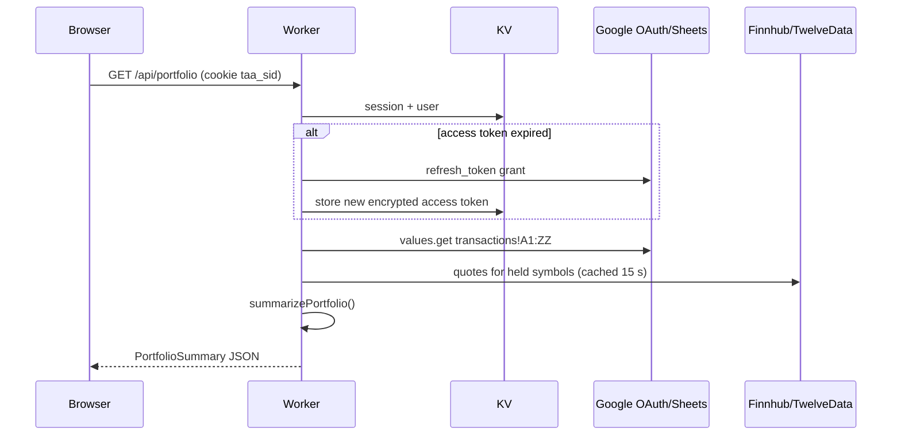

# Architecture

## Runtime topology

The app is **one Cloudflare Worker** that serves two kinds of traffic:

- **Static assets** (`apps/web/dist`), with SPA fallback. Security headers come from `public/_headers`.
- **`/api/*` and `/auth/*`**, handled by the Worker itself (`run_worker_first`).

| Binding | Purpose |
|---|---|
| `ASSETS` | Built React PWA |
| `KV` | `session:{sid}` → encrypted access token + expiry (TTL 30 d) · `user:{sub}` → profile, encrypted refresh token, spreadsheetId, schemaVersion · `db:{owner}:{table}` → dev-mode data · `runnertoken:{sha256}` / `runner:{sub}` → local-runner token hash and last check-in · `runnerqueue:{sub}` → the job queue (one document) · `runnerctx:{sub}:{job}` → the fact sheet given to the runner (TTL 1 d) |
| Cron `30 21 * * 1-5` | Daily watchlist sweep (`src/cron.ts`) |

## Request flow (portfolio)



## Sign-in flow

1. `GET /auth/login` sets a random `state` cookie and redirects to Google. Scopes are `openid email profile drive.file`, with `access_type=offline` and `prompt=consent`.
2. `GET /auth/callback`:
   - Verifies `state` and exchanges the code.
   - Fetches userinfo and checks `email_verified` and `ALLOWED_EMAILS`.
   - Encrypts the refresh token and finds or creates the spreadsheet, running `ensureSchema`.
   - Creates the session and sets the `taa_sid` cookie.
3. `POST /auth/logout` revokes the token, deletes the session and clears the cookie.

## Modules

```
packages/shared        types.ts · schema.ts (TABLES, SCHEMA_VERSION) · portfolio.ts (computePositions, summarizePortfolio)
packages/market-data   types.ts (MarketDataProvider) · providers/{finnhub,twelvedata}.ts · router.ts (chains + TTL cache) · indicators.ts
packages/agents        llm/{gemini,anthropic,router}.ts · context.ts (fact sheet) · prompts.ts · pipeline.ts · json.ts (extract + normalize)
apps/worker/src        index.ts (Hono app + scheduled) · env.ts · cron.ts
                       lib/{crypto,google,sheets,store,session,http,telegram}.ts
                       routes/{auth,market,portfolio,watchlists,analysis}.ts · services/{deps,analysis}.ts
apps/web/src           App.tsx · lib/{api,router,format}.ts · hooks/useAsync.ts
                       components/{NavBar,SymbolSearch,PriceChart,DecisionCard,TransactionForm,ui}.tsx
                       pages/{Login,Portfolio,Watchlists,Symbol,Settings}Page.tsx
```

## Design constraints

- **Workers runtime:** there are no Node APIs, and CPU time is limited per request, but `fetch` wait time doesn't count. Deep analysis spends most of its time awaiting the LLM, so it stays within limits.
- **Google Sheets quotas:** about 60 read and 60 write requests per minute per user. Each store call costs 1–3 requests. List endpoints read a whole tab, which is fine at personal scale.
- **Provider rate limits:**
  - Finnhub free tier: about 60/min.
  - Twelve Data free tier: 8/min and 800/day.
  - The router caches per isolate (quotes 15 s, candles 30 min, profile 24 h).
  - A cron sweep makes about 5 provider calls per symbol. That is why `CRON_MAX_SYMBOLS` defaults to 10.
- **Cron has no user request.** It loads each allow-listed user from KV, refreshes their Google token with the stored refresh token, and runs on their sheet.

## Failure handling

| Failure | Behavior |
|---|---|
| A provider throws | The router tries the next provider in the chain. If all fail, it returns 502 with the provider errors. |
| Gemini fails or is rate-limited | `FallbackLLM` retries the same request on Claude. |
| Partial market data | The context marks the missing pieces, and agents are told to lower their confidence. If there is neither a quote nor candles, the API returns 404. |
| Google token is revoked | The API returns 401, and the UI shows the login page. |
| Model returns malformed JSON | `extractJson` handles code fences and stray prose, and `normalizeReport` coerces the result to a valid report (decision defaults to HOLD). |
